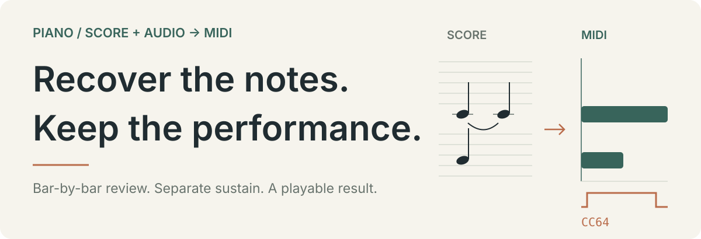
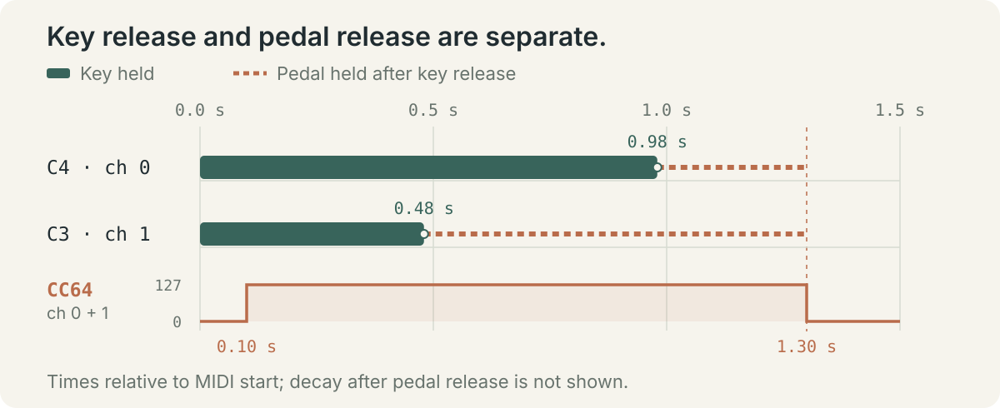

# score-audio-to-midi

[简体中文](README.md) · **English**

<p align="center">
  
</p>

**Reconstruct editable, playable piano MIDI from a complete score and its matching recording.** This Codex skill includes helpers for preparing evidence, matching candidate notes, exporting MIDI, and rendering previews. The score anchors note and voice coverage; the recording supplies evidence for timing, dynamics, tempo changes, and pedaling.

[Quick start](#quick-start) · [Pedal example](#pedal-example) · [Workflow](#workflow) · [Helper scripts](#scripts) · [Limitations](#limits)

<a id="pedal-example"></a>
## Start with a pedal example

<p align="center">
  
</p>

The diagram uses the repository's [runnable project JSON](examples/pedal-demo.json). Times are relative to the beginning of the exported MIDI:

| Event | Time | Stored as |
| --- | --- | --- |
| C4 and C3 start | 0.00 s | Individual note-on events |
| C3 release / C4 release | 0.48 / 0.98 s | Individual note-off events |
| Sustain pedal down / up | 0.10 / 1.30 s | CC64 on each active channel |

**The pedal controls sustain after key release; note lengths do not substitute for it.** Dashed segments show where the pedal remains down after a key is released. Natural decay after pedal release is not shown. This two-note example demonstrates the data format and event relationships, not full-piece transcription quality or accuracy.

<a id="quick-start"></a>
## Quick start

### 1. Install the skill

Clone the repository into your personal skills directory (works in PowerShell or a macOS / Linux shell):

```sh
git clone https://github.com/gou-xing-xing/score-audio-to-midi.git "$HOME/.agents/skills/score-audio-to-midi"
```

Cloning a private repository requires access and GitHub authentication. If the destination already exists, inspect your current installation first. Open a new Codex session after installation.

### 2. Prepare the inputs and invoke it

Place the complete score and the matching piano recording in one directory, then send Codex:

```text
$score-audio-to-midi D:/Music/My Piece/
Reconstruct MIDI from the score and performance audio in this directory. Review the entire piece for missing notes, rhythm, key durations, and independent sustain pedaling, and provide an audio preview.
```

| Input | Guidance |
| --- | --- |
| Score | PDF, images, MusicXML / MXL; prefer MusicXML of the same arrangement and retain the score for visual review |
| Performance | A matching piano recording in a format FFmpeg can decode |
| Preview instrument | A local piano SF2; confirm its actual bank / preset. No SoundFont is included |

The scripts require **Python 3.11+**, with dependencies installed as needed. The workflow checks input pairing and completeness, creates a separate working directory, and preserves the originals. It prefers local processing and does not require uploading scores or recordings.

### 3. Optional: run the two-note example

Run these commands from the repository root. Outputs go outside the repository, into `../midi-demo/`:

```sh
python -m pip install mido
python scripts/midi_project.py export examples/pedal-demo.json ../midi-demo/pedal-demo.mid
python scripts/midi_project.py verify examples/pedal-demo.json ../midi-demo/pedal-demo.mid
```

Export also produces `.validation.json` and `.coverage.tsv` files. The example contains 3 score noteheads, 2 physical keystrokes, and 2 reviewed bars: two tied noteheads map to one keystroke, and the second bar is entirely rests. Export refuses to overwrite an existing MIDI by default.

<a id="workflow"></a>
## Reconstruction and review

1. **Read the complete score.** Inventory pages, bars, voices, and noteheads; unfold repeats and check ties, octave lines, accidentals, and ornaments.
2. **Align the performance.** Use clear chords and bass attacks to establish the time origin, tempo changes, and local onsets. Preserve supported hand offsets and arpeggiation.
3. **Estimate key release and pedaling separately.** Track score beats, performed onsets, physical key releases, pedal releases, and acoustic decay as distinct quantities.
4. **Review every bar.** Check quiet inner voices, bass notes, repeated pitches, and chord members against both sources. Keep unmatched items and evidence for changes; a model's missed detection is not grounds for deleting a score note.
5. **Export and read back.** Write Type 1 MIDI with the same CC64 curve on every active piano channel. Check note pairing, score coverage, tempo maps, and pedal resets.
6. **Render from the final file.** Record MIDI and SF2 hashes, verify the playback engine's actual response to CC64, and check levels, clipping, and the ending's decay.

During revisions, accepted onsets and tempo maps become the baseline. Fixing pedaling or missing notes should not requantize an already accepted performance. The agent reviews the entire piece; the user does not need to locate every error first.

## What you receive

- **One clearly recommended main MIDI**, with independent CC64 sustain events where the music requires them.
- **An audio preview rendered from that final MIDI**: WAV, with MP3 available when needed.
- **A coverage table, validation report, and brief review notes**, identifying the checks performed, performance deviations, and remaining inferences.
- **An editable project JSON and supporting evidence**, retained in the working directory.

Only one main version is recommended by default. Pedal-free or quantized alternatives are added when requested.

<a id="scripts"></a>
## Helper scripts

These helpers organize evidence and validate outputs. **They do not automatically read arbitrary scores or reconstruct an entire piece.** The project JSON must be built and reviewed against the score and recording. See the [project format reference](references/project-format.md) for full parameters and examples.

- **[prepare_inputs.py](scripts/prepare_inputs.py)** prepares input hashes, PDF pages and vector evidence, and decoded audio. Uses `pypdfium2`, `pillow`, `pdfplumber`, and FFmpeg or `imageio-ffmpeg` as needed.

- **[match_audio.py](scripts/match_audio.py)** matches pitch/onset candidates one-to-one, retains unmatched items, and does not edit notes. Requires `numpy` and `scipy`.

- **[midi_project.py](scripts/midi_project.py)** exports Type 1 MIDI and performs coverage, readback, and revision baseline checks. Requires `mido`.

- **[render_preview.py](scripts/render_preview.py)** renders an SF2 preview, probes pedal response, and compares each channel. Requires `mido`, `numpy`, and `tinysoundfont`; MP3 also needs FFmpeg.

Render the example with your own piano SF2, replacing the placeholder with its actual path:

```sh
python -m pip install numpy tinysoundfont
python scripts/render_preview.py ../midi-demo/pedal-demo.mid --sf2 /path/to/piano.sf2 --wav ../midi-demo/preview.wav
```

The defaults are `--bank 0 --preset 0`; verify that they select a piano in your SF2. The default `--pedal-mode auto` probes native CC64 support. If it is ineffective, key release is delayed only in the rendering layer; the exported MIDI is unchanged. The render report records the selected mode and per-channel pedal comparisons.

<a id="limits"></a>
## Limitations

- **Designed for a single piano.** Multi-instrument recordings, different arrangements, or incomplete scores need a separate assessment.
- **The original performance MIDI is not uniquely recoverable.** Physical key releases under sustain and a final pedal release missing from the recording may require documented inference.
- **The bundled format and toolchain currently support CC64.** Soft pedal CC67 requires extending the format, export, readback, and instrument response checks. `p` / `pp` alone is not evidence of una corda.
- **Structural validation does not replace musical review.** Passing coverage and readback checks does not establish that every score interpretation or listening judgment is correct. If direct listening is unavailable, the checks actually performed must be stated.
- **Preview rendering is a sampled approximation.** The adapter does not fully model sympathetic resonance, repedaling, or half-pedaling. The chosen SF2 determines the timbre.
- **No models, weights, or SF2 files are bundled or automatically downloaded.** Select tools only when needed and check their licenses and runtime compatibility.

## Further reading

| Document | Contents |
| --- | --- |
| [Skill entry point](SKILL.md) | Full agent workflow and delivery requirements |
| [Score and audio review](references/reconstruction.md) | Score reading, alignment, missing notes, and pedal evidence |
| [Project format and scripts](references/project-format.md) | JSON, commands, coverage rules, and revision baselines |
| [Quality checks and preview rendering](references/quality-and-rendering.md) | CC64, playback, endings, and revision checks |

These detailed references are currently in Chinese. The repository does not yet include a license; third-party tools, models, and SoundFonts retain their own licenses.
