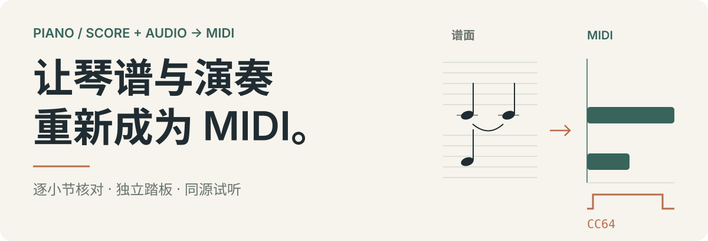
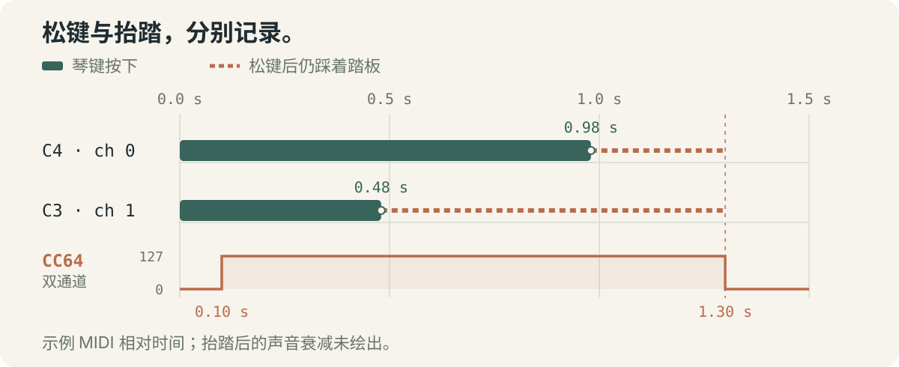

# score-audio-to-midi

**简体中文** · [English](README.en.md)

<p align="center">
  
</p>

**结合完整琴谱与对应的钢琴录音，复原可编辑、可播放的 MIDI。** 这是一个供 Codex 使用的技能，附带证据准备、音符候选匹配、MIDI 导出与试听脚本。谱面负责音符与声部的完整性，录音提供实际起音、力度、速度变化与踏板的线索。

[快速开始](#quick-start) · [踏板示例](#pedal-example) · [复原流程](#workflow) · [辅助脚本](#scripts) · [使用边界](#limits)

<a id="pedal-example"></a>
## 先看一个踏板例子

<p align="center">
  
</p>

这张图来自仓库中的 [可运行项目 JSON](examples/pedal-demo.json)。以导出 MIDI 的起点为零：

| 事件 | 时间 | 存储位置 |
| --- | --- | --- |
| C4、C3 起音 | 0.00 秒 | 各自的 note-on |
| C3 松键 / C4 松键 | 0.48 / 0.98 秒 | 各自的 note-off |
| 踩下 / 抬起延音踏板 | 0.10 / 1.30 秒 | 两个活动通道各自的 CC64 |

**松键之后的延音由踏板控制，不靠拉长音符代替。** 图中虚线表示松键后仍踩着踏板的区间；声音在抬踏后的自然衰减未绘出。这个两音例子用于解释数据格式与事件关系，不代表整曲转录质量或准确率。

<a id="quick-start"></a>
## 快速开始

### 1. 安装技能

将仓库克隆到个人技能目录（命令可用于 PowerShell 或 macOS / Linux 终端）：

```sh
git clone https://github.com/gou-xing-xing/score-audio-to-midi.git "$HOME/.agents/skills/score-audio-to-midi"
```

克隆私有仓库需要访问权限和 GitHub 认证。若目录已经存在，请先检查现有安装。安装后打开新的 Codex 会话。

### 2. 准备输入并调用

把同一首作品的完整琴谱和对应演奏音频放在一个目录，再向 Codex 发送：

```text
$score-audio-to-midi D:/Music/My Piece/
请结合这里的琴谱和演奏音频复原 MIDI，完成全曲漏音、节奏、时值与独立踏板检查，并提供试听。
```

| 输入 | 建议 |
| --- | --- |
| 琴谱 | PDF、图片、MusicXML / MXL；优先提供同一编配的 MusicXML，并保留谱面供核对 |
| 演奏 | 与琴谱对应的钢琴录音，使用 FFmpeg 可解码的格式 |
| 试听音源 | 本地钢琴 SF2；确认实际 bank / preset，技能不附带音源 |

运行脚本需要 **Python 3.11+**，依赖按需安装。复原前会检查输入配对和完整范围，建立独立工作目录并保留原文件。优先本地处理，技能不要求上传琴谱或录音。

### 3. 可选：先跑通两音示例

在本仓库根目录执行；输出写到仓库外的 `../midi-demo/`：

```sh
python -m pip install mido
python scripts/midi_project.py export examples/pedal-demo.json ../midi-demo/pedal-demo.mid
python scripts/midi_project.py verify examples/pedal-demo.json ../midi-demo/pedal-demo.mid
```

导出同时生成 `.validation.json` 与 `.coverage.tsv`。示例包含 3 个谱面音头、2 次实际击键和 2 个已核对小节：连音线的两个音头对应一次击键，第二小节为全休止。重复导出默认拒绝覆盖已有 MIDI。

<a id="workflow"></a>
## 如何复原与核对

1. **完整读谱。** 建立页码、小节、声部和音头清单，展开反复，核对连音线、八度线、临时记号及装饰音。
2. **对齐演奏。** 用清晰的和弦与低音确定时间原点、速度变化和局部起音，保留可确认的左右手先后与琶音。
3. **分开估计松键与踏板。** 分别记录谱面拍点、实际起音、物理松键、踏板释放与声音衰减；不把带踏板的声音结束当作松键。
4. **逐小节检查全曲。** 对照谱面和录音检查弱内声、低音、同音重奏及和弦成员；保留未匹配项和修改依据，不用模型漏检作为删音理由。
5. **导出后回读。** 生成 Type 1 MIDI，把同一 CC64 曲线写入所有活动钢琴通道，核对音符配对、覆盖表、速度图和踏板复位。
6. **从最终文件生成试听。** 绑定 MIDI 与 SF2 的哈希，验证播放引擎对 CC64 的实际响应，检查响度、削波与结尾自然衰减。

返修时，用户已认可的起音和速度图作为基线保留。修踏板或漏音时，不重新量化已认可的全曲节奏。全曲核对由代理完成，不要求用户先找出每一个问题时间点。

## 你会拿到什么

- **一份明确推荐的主 MIDI**，音乐需要时包含独立 CC64 延音踏板。
- **由这份最终 MIDI 生成的试听**：WAV，可按需输出 MP3。
- **覆盖表、校验报告和简短复核说明**，列明检查范围、演奏差异与仍需推断的部分。
- **可继续修订的项目 JSON 和工作证据**，保存在工作目录中。

默认只推荐一份主版本；需要无踏板或量化版本时再增加变体。

<a id="scripts"></a>
## 辅助脚本

脚本帮助整理证据和验证输出，**不会自动完成通用读谱或整曲复原**。项目 JSON 需要结合谱面与录音建立并复核。完整参数、格式及用法见 [项目格式文档](references/project-format.md)。

- **[prepare_inputs.py](scripts/prepare_inputs.py)**：输入哈希、PDF 页面与矢量证据、录音解码。按需使用 `pypdfium2`、`pillow`、`pdfplumber`，以及 FFmpeg 或 `imageio-ffmpeg`。

- **[match_audio.py](scripts/match_audio.py)**：同音高一对一候选匹配，保留未匹配项，不改音符。依赖 `numpy`、`scipy`。

- **[midi_project.py](scripts/midi_project.py)**：Type 1 MIDI 导出、覆盖表、文件回读与修订基线比较。依赖 `mido`。

- **[render_preview.py](scripts/render_preview.py)**：指定 SF2 试听、踏板响应探测与逐通道对照。依赖 `mido`、`numpy`、`tinysoundfont`；MP3 另需 FFmpeg。

用你已有的钢琴 SF2 渲染示例（将音源路径换成实际文件）：

```sh
python -m pip install numpy tinysoundfont
python scripts/render_preview.py ../midi-demo/pedal-demo.mid --sf2 /path/to/piano.sf2 --wav ../midi-demo/preview.wav
```

默认 `--bank 0 --preset 0`，需确认它们在你的 SF2 中对应钢琴。默认 `--pedal-mode auto` 会探测原生 CC64；若无效，仅在渲染层延迟松键，导出的 MIDI 不变。渲染报告记录所用模式和逐通道踏板对照结果。

<a id="limits"></a>
## 使用边界

- **面向单一钢琴。** 多乐器录音、不同编配或不完整谱面需要另行判断处理方式。
- **不能保证唯一恢复原始演奏 MIDI。** 带踏板的物理松键、未录到的最后抬踏等可能需要推断，交付时应说明依据。
- **当前附带格式和工具链支持 CC64。** 柔音踏板 CC67 需要扩展数据格式、导出、回读和音源响应检查；`p` / `pp` 本身不是柔音踏板证据。
- **结构校验不能代替音乐复核。** 通过覆盖与回读检查，并不自动证明读谱判断或听感完全正确。无法直接听音时应明确实际采用的检查方法。
- **试听是采样近似。** 渲染适配器不完整模拟琴弦共鸣、重新踩踏或半踏板；播放音色取决于所用 SF2。
- **不附带模型、权重或 SF2，也不会自动下载。** 仅在工作需要时选择合适工具，并核对其许可与环境兼容性。

## 进一步阅读

| 文档 | 内容 |
| --- | --- |
| [技能入口](SKILL.md) | 代理执行的完整流程与交付约束 |
| [谱面与录音核对](references/reconstruction.md) | 读谱、对齐、漏音和踏板取证 |
| [项目格式与脚本](references/project-format.md) | JSON、命令参数、覆盖规则与修订基线 |
| [质量检查与试听](references/quality-and-rendering.md) | CC64、播放链路、结尾和返修检查 |

上述详细参考文档目前以中文提供。仓库尚未添加许可证；第三方工具、模型与音源适用各自的许可。
